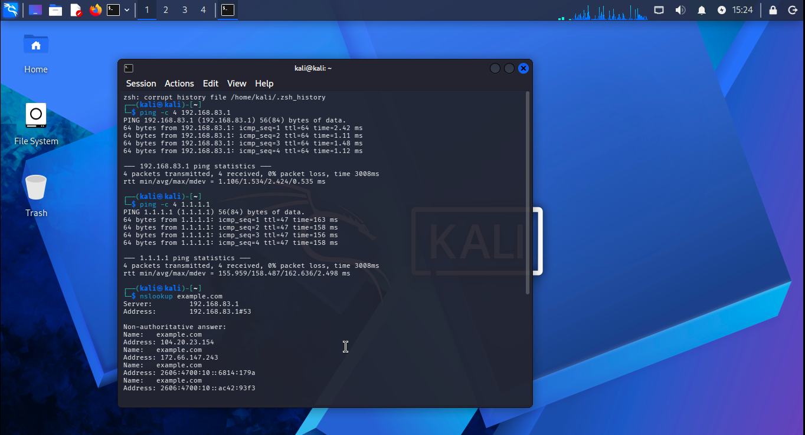

## Connectivity and DNS Testing

### Objective
Test connectivity between the Kali Linux VM, its default gateway, and an external IP address, then verify DNS resolution.

### Commands Executed
```bash
ping -c 4 192.168.83.1
ping -c 4 1.1.1.1
nslookup example.com
```

### Findings

**1. Default Gateway**
- Target: `192.168.83.1`
- Packets transmitted: 4
- Packets received: 4
- Packet loss: 0%
- Average round-trip time: 1.534 ms

**2. External IP Connectivity**
- Target: `1.1.1.1`
- Packets transmitted: 4
- Packets received: 4
- Packet loss: 0%
- Average round-trip time: approximately 158.487 ms

**3. DNS Resolution**
- Domain queried: `example.com`
- DNS server: `192.168.83.1`
- Result: DNS resolution succeeded.
- IPv4 and IPv6 addresses were returned.

### Analysis
The Kali VM successfully reached its configured gateway and the external IP address tested. DNS resolution also succeeded through the configured DNS server.

These results confirm basic gateway connectivity, external ICMP reachability, and successful DNS resolution at the time of testing.

### SOC Relevance
These checks provide a baseline for troubleshooting network connectivity and understanding DNS activity. During a security investigation, an analyst can use similar tests to help distinguish connectivity issues from name-resolution problems.

### Limitations
These tests do not establish that all external destinations are reachable or that the network is free from malicious activity. Additional monitoring and investigation would be required to assess security.

### Evidence

The screenshot below shows the terminal output from the connectivity and DNS tests performed during this investigation.


