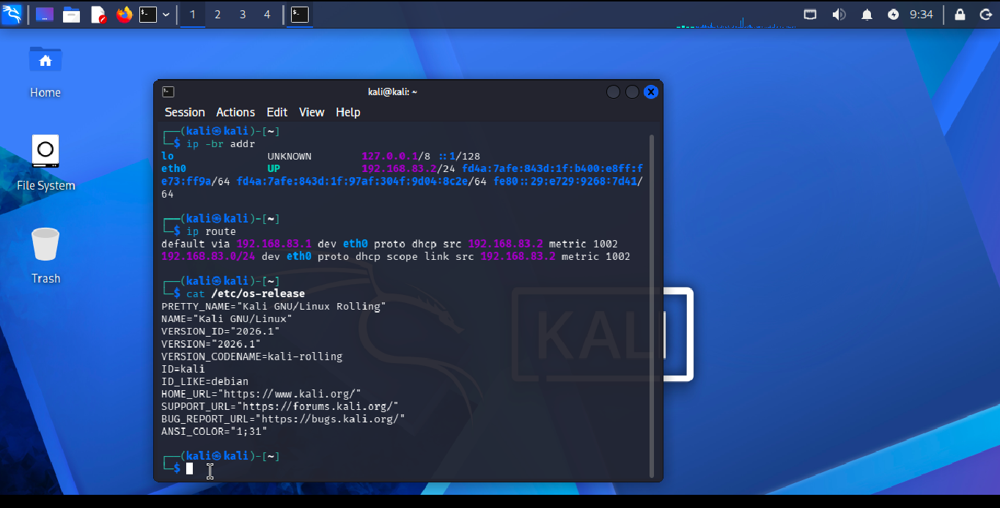

# Project 01: Network Interface and Routing Inspection

## Status
Initial evidence collected — investigation in progress.

## Objective
Identify the network interface, IPv4 address, default gateway, and operating system of a Kali Linux virtual machine running in UTM.

## Environment
- Virtualization: UTM
- Operating system: Kali GNU/Linux Rolling
- Reported release: 2026.1

## Commands Executed
```bash
ip -br addr
ip route
cat /etc/os-release
```

## Observations
- The `eth0` network interface was displayed as `UP`.
- The assigned IPv4 address was `192.168.83.2/24`.
- The routing table showed `192.168.83.1` as the default gateway.
- The directly connected network route was `192.168.83.0/24`.
- The operating system information identified Kali GNU/Linux Rolling, version `2026.1`.

## Initial Analysis
The VM has an active network interface with an IPv4 address and a configured default route. These observations show that the system has network configuration in place. They do not yet prove that external connectivity or DNS resolution works.

## Next Steps
1. Test connectivity to the configured gateway.
2. Test connectivity to an external IP address.
3. Test DNS resolution.
4. Record actual results and investigate any failures.

## SOC Relevance
Understanding network interfaces, IP addressing, and routing is foundational for interpreting network logs and investigating connectivity or suspicious-traffic alerts.

## Evidence: Network Interface and Routing

The screenshot below shows the network interface, IPv4 address, default gateway, and Kali Linux version observed during the initial lab setup.


## Disclaimer
This is a learning exercise conducted in the user's own virtual machine environment.
